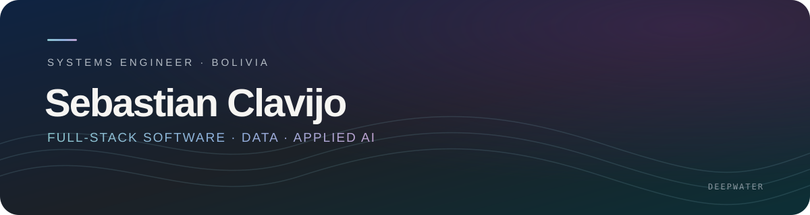

  

<h1 align="center">Hi, I’m Sebastian Clavijo Alessandri</h1>

  <strong>Systems Engineer · Full-Stack Developer · Data Scientist</strong> 
  Bolivia · Open to web and software projects

  <a href="https://www.linkedin.com/in/sebastian-clavijo-alessandri">LinkedIn</a>
  &nbsp;·&nbsp;
  <a href="https://sebclav-portfolio.sebasclavijoalessandri.workers.dev/">Portfolio</a>

---

I am a Systems Engineer focused on building scalable, production-ready applications. I am currently bridging the gap between robust software architecture and data-driven insights, specializing in **Data Engineering** and the implementation of **Machine Learning** workflows.

## Current focus

- 🐍 **Advanced Python:** Automating data pipelines and ETL processes.
- 🧠 **Deep Learning:** Exploring neural network architectures (MLP, CNN) and PyTorch fundamentals.
- 📊 **Data Engineering:** Optimizing high-performance backends for data-intensive applications.
- 🛠 **Full-Stack Development:** Building web applications across frontend and backend with React, TypeScript, Node.js, and NestJS.

## Selected projects

### Nexa · Operations software for small and medium-sized businesses

In active development. Nexa is being built to help businesses manage warehouse inventory and product distribution. GPS-supported delivery workflows are within the product’s planned scope.

**Stack:** React · TypeScript · NestJS · PostgreSQL · Tailwind CSS

### FTS · Mask Model Language

A deterministic knowledge-compilation system. It compiles domain knowledge from YAML into executable JSON masks. Hash-indexed retrieval is designed to answer covered queries in **O(1)**, without model inference or token use on that path.

**Stack:** Python · FastAPI · YAML · JSON

### 🏗 ERP system for cement manufacturers

Final degree project · Grade: **95/100**. A cross-platform Enterprise Resource Planning system managing industrial workflows. **Data impact:** integrated Power BI for operational analytics and KPI visualization.

**Stack:** Node.js · Express · PostgreSQL · Vue.js · Vuetify · Flutter · Power BI

### Market research app

A mobile app for field data collection and structured survey work.

**Stack:** Flutter · Dart

## Tech stack

**Core Development**

**Data Science & AI (Learning & Implementing)**

**Tools**

## Education

- **Systems Engineering**, Universidad Privada del Valle
- **Data Analysis with Python**, Universidad Franz Tamayo (UniFranz) · **95/100**
- **Machine Learning and Data Science**, Universidad Privada Boliviana · **96/100**

## Academic work

Explore my academic repositories and project work at [SebastianClavijoA on GitHub](https://github.com/SebastianClavijoA).

